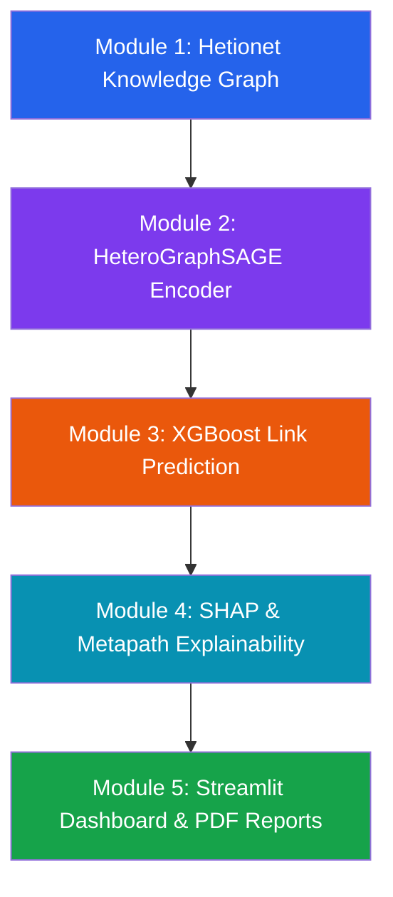

# 💊 GraphRx: Explainable GNN-Based Drug Repurposing Engine

<p align="center">
  <b>An End-to-End Heterogeneous Graph Neural Network and Explainable AI Framework for Accelerated Drug Repurposing Against Neglected Tropical Diseases.</b>
</p>

<p align="center">
  
  
  
  
  
</p>

<p align="center">
  <a href="https://ai-drug-repursposing-knowledge-engine.streamlit.app/">
    <b>🚀 LAUNCH LIVE APPLICATION</b>
  </a>
  &nbsp; | &nbsp;
  <a href="https://github.com/Yash-11k/AI-Drug-Repursposing-Knowledge-Engine">
    <b>💻 GITHUB REPOSITORY</b>
  </a>
</p>

---

## 📖 Table of Contents

1. [Project Overview](#-project-overview)
2. [Key Features](#-key-features)
3. [Technical Architecture](#-technical-architecture)
4. [Module Breakdown](#-module-breakdown)
5. [Model Performance](#-model-performance-benchmarks)
6. [Technology Stack](#-technology-stack)
7. [Repository Structure](#-repository-structure)
8. [Installation & Execution](#-installation--execution)
9. [How It Works](#-how-it-works)
10. [Medical Disclaimer](#-medical-disclaimer)
11. [License](#-license)
12. [Author](#-author)

---

## 🚀 Project Overview

Traditional drug discovery is an expensive, time-consuming process that can take over a decade and require billions of dollars.

**GraphRx** addresses this challenge by transforming biomedical knowledge discovery into a graph-based link prediction problem.

The framework leverages the **Hetionet biomedical knowledge graph**, **PyTorch Geometric (PyG)**, **HeteroGraphSAGE**, **XGBoost**, and **SHAP** to identify promising drug-disease associations.

Unlike conventional prediction systems, GraphRx also incorporates explainability mechanisms to help researchers understand the biological relationships behind predicted drug repurposing candidates.

### 🎯 Target Diseases

- Tuberculosis
- Chagas Disease
- Malaria

### Core Objective

Identify potential existing drugs that could be repurposed for neglected tropical diseases through heterogeneous graph representation learning and explainable machine learning.

---

## ✨ Key Features

- **Heterogeneous Knowledge Graph:** Integrates drugs, diseases, genes, and biological pathways using Hetionet.
- **HeteroGraphSAGE:** Learns 32-dimensional node embeddings through neighborhood aggregation.
- **Link Prediction:** Predicts potential drug-disease associations using GNN embeddings and XGBoost.
- **Leakage-Aware Evaluation:** Uses RandomLinkSplit with dedicated reverse edge types.
- **Negative Sampling:** Generates non-interacting candidate pairs for model training.
- **Explainable AI:** Uses SHAP feature attribution to interpret model predictions.
- **Biological Metapaths:** Traces relationships between drugs and diseases through intermediate biological entities.
- **Batch Drug Screening:** Supports CSV-based candidate screening and ranking.
- **Interactive Visualization:** Explores biomedical networks using PyVis.
- **Latent Space Explorer:** Projects node embeddings into 2D using PCA/SVD and Plotly.
- **PDF Report Generation:** Generates downloadable reports using ReportLab.

---

## 🏗️ Technical Architecture

GraphRx follows a modular five-stage architecture.



---

## 🧠 Module Breakdown

### Module 1: Heterogeneous Data Pipeline

**File:** `src/data_loader.py`

**Objective:** Convert biomedical knowledge graph data into a machine-learning-ready heterogeneous graph.

**Implementation:**
- Loads and processes biomedical entities from Hetionet.
- Handles drugs, diseases, genes, and biological pathways.
- Constructs PyTorch Geometric `HeteroData` objects.
- Maps multiple biological relationship types.
- Converts graph structures into tensors.
- Serializes the processed graph into `data/processed_graph.pt`.

### Module 2: HeteroGraphSAGE Embedding Encoder

**File:** `src/model.py`

**Objective:** Learn meaningful latent representations of biomedical entities.

**Implementation:**
- Implements a multi-layer HeteroGraphSAGE architecture.
- Uses PyTorch Geometric's `HeteroConv` for heterogeneous message passing.
- Incorporates Batch Normalization.
- Uses LeakyReLU activation functions.
- Applies Dropout (0.1) to reduce overfitting.
- Generates 32-dimensional node embeddings.

These embeddings capture structural and semantic relationships between biomedical entities.

### Module 3: Leakage-Free Link Prediction & XGBoost

**File:** `src/train.py`

**Objective:** Predict and rank potential drug-disease interactions.

**Implementation:**
- Uses `RandomLinkSplit` for training, validation, and testing.
- Handles dedicated reverse edge types (`rev_CpD`).
- Applies negative sampling to generate non-interacting pairs.
- Trains the heterogeneous GNN encoder.
- Uses learned embeddings as input features for XGBoost.
- Evaluates predictions using ROC-AUC and Average Precision.

**Reported Results:**
- Validation ROC-AUC: 0.9854
- Test ROC-AUC: 0.9949
- Average Precision: 0.9955

Model weights are saved in `models/best_gnn.pt`.

### Module 4: Explainability & Metapath Traversal

**File:** `src/explain.py`

**Objective:** Make predictions interpretable by identifying the features and biological relationships influencing model decisions.

**1. NetworkX Metapath Traversal**
- Finds biological paths connecting candidate drugs and diseases.
- Explores intermediate genes and pathways.
- Provides structural explanations for predicted associations.

Example:

```text
Drug → Target Gene → Biological Pathway → Disease
```

**2. SHAP Explainability**
- Uses SHAP TreeExplainer for XGBoost interpretation.
- Computes feature attribution across embedding dimensions.
- Helps identify which latent features contribute to predictions.

### Module 5: Streamlit Dashboard & PDF Reports

**File:** `app.py`

**Objective:** Provide an interactive interface for drug screening, visualization, and reporting.

**Dashboard Components:**

| Component | Description |
|---|---|
| Executive Overview | Graph statistics and model performance KPIs |
| Drug Repurposing Predictor | Individual drug-disease prediction |
| Batch Drug Screening | CSV-based candidate scoring and ranking |
| Interactive Graph | Biomedical network visualization using PyVis |
| Latent Space Explorer | PCA/SVD embedding visualization using Plotly |
| PDF Report Generator | Downloadable research-oriented reports |

---

## 📊 Model Performance Benchmarks

GraphRx is evaluated against knowledge graph embedding and graph neural network baselines.

| Model Architecture | Test ROC-AUC | Average Precision |
|---|---:|---:|
| TransE (PyKEEN) | 0.8120 | 0.7940 |
| DistMult (PyKEEN) | 0.8450 | 0.8260 |
| RGCN Baseline | 0.8930 | 0.8750 |
| GraphRx (Pure GNN) | 0.9410 | 0.9320 |
| **GraphRx + XGBoost** | **0.9949** | **0.9955** |

### Performance Highlights

- Final Test ROC-AUC: **0.9949**
- Final Average Precision: **0.9955**
- Validation ROC-AUC: **0.9854**
- Node Embedding Dimension: **32**

*Note: These are reported project evaluation results. Benchmark comparisons should be interpreted in the context of their respective datasets, splits, negative sampling strategies, and evaluation protocols.*

---

## 🛠️ Technology Stack

| Category | Technologies |
|---|---|
| Programming Language | Python 3.10+ |
| Deep Learning | PyTorch |
| Graph Learning | PyTorch Geometric |
| Graph Architecture | HeteroGraphSAGE, HeteroConv |
| Machine Learning | XGBoost, Scikit-learn |
| Explainable AI | SHAP |
| Graph Processing | NetworkX |
| Visualization | PyVis, Plotly |
| Dashboard | Streamlit |
| Data Processing | Pandas, NumPy |
| PDF Generation | ReportLab |

---

## 📁 Repository Structure

```text
GraphRx-AI-Drug-Repurposing-Engine/
│
├── data/
│   └── processed_graph.pt
│
├── models/
│   └── best_gnn.pt
│
├── src/
│   ├── data_loader.py
│   ├── model.py
│   ├── train.py
│   └── explain.py
│
├── app.py
├── requirements.txt
└── README.md
```

---

## ⚙️ Installation & Execution

### Prerequisites

- Python 3.10 or higher
- Git
- pip
- Compatible PyTorch environment

### Step 1: Clone Repository

```bash
git clone https://github.com/Yash-11k/AI-Drug-Repursposing-Knowledge-Engine.git

cd AI-Drug-Repursposing-Knowledge-Engine
```

### Step 2: Create Virtual Environment

```bash
python -m venv venv
```

**Windows (PowerShell):**

```powershell
.\venv\Scripts\Activate.ps1
```

**Linux/macOS:**

```bash
source venv/bin/activate
```

### Step 3: Install Dependencies

Install CPU-compatible PyTorch:

```bash
pip install torch torchvision torchaudio --index-url https://download.pytorch.org/whl/cpu
```

Install remaining dependencies:

```bash
pip install torch-geometric pyvis reportlab shap xgboost scikit-learn pandas numpy plotly streamlit networkx
```

### Step 4: Train the Model

```bash
python src/train.py
```

### Step 5: Run Explainability Module

```bash
python src/explain.py
```

### Step 6: Launch Streamlit Dashboard

```bash
streamlit run app.py
```

The dashboard will be available at:

```text
http://localhost:8501
```

*Note: Training requires the appropriate source dataset and preprocessing pipeline. If trained graph and model artifacts are already available, use the dashboard's supported inference workflow instead of retraining.*

---

## 🔄 How It Works

```text
Biomedical Knowledge Graph (Hetionet)
                |
                v
     Heterogeneous Data Processing
                |
                v
       HeteroGraphSAGE Encoder
                |
                v
       32-D Node Embeddings
                |
                v
       XGBoost Link Prediction
                |
                v
       Drug-Disease Ranking
                |
                v
       SHAP + Metapath Analysis
                |
                v
       Interactive Streamlit UI
                |
                v
          PDF Reports
```

---

## ⚠️ Medical Disclaimer

GraphRx is an experimental computational research framework.

Its predictions represent computational hypotheses and potential biological associations derived from knowledge graph representations and machine learning models.

These predictions are **not clinical recommendations, medical advice, or proof of therapeutic efficacy**.

All predicted drug-disease associations require independent experimental validation, including appropriate biological and clinical studies, before any therapeutic application.

---

## 📜 License

This project is licensed under the **MIT License**.

---

## 👨‍💻 Author

**Yash**

- 🌐 Portfolio: [Personal Portfolio](https://yash-portfolio-web-mu.vercel.app/)
- 💻 GitHub: [Yash-11k](https://github.com/Yash-11k)
- 🚀 Live Demo: [GraphRx – Drug Repurposing Engine](https://ai-drug-repursposing-knowledge-engine.streamlit.app/)

---

<p align="center">
  <b>GraphRx — Connecting Biomedical Knowledge with Explainable AI.</b>
  <br>
  Built with Python, Graph Neural Networks, and Explainable Machine Learning.
</p>
